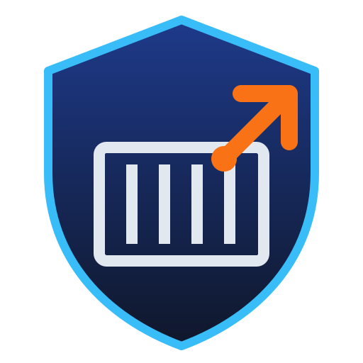
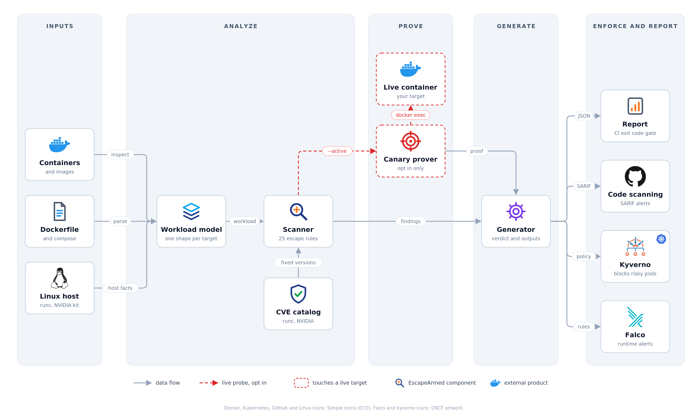

<p align="center">
  
</p>

<h1 align="center">EscapeArmed</h1>

<p align="center"><b>Prove whether a container can escape, then generate the policy that stops it.</b></p>

<p align="center">
  
  
  
  
  
  
</p>

## Overview

EscapeArmed answers one question about a container: **can it reach the host?**

It does this in three steps:

- **Find.** It reads how a workload runs (a live container, an image, a Dockerfile, a compose file, or the host) and flags escape primitives: privileged mode, dangerous capabilities, mounted runtime sockets, host path mounts, shared host namespaces, disabled AppArmor or seccomp, host cgroup namespaces, root without user namespaces, and the setups behind the November 2025 runc escapes and NVIDIAScape.
- **Prove.** If you opt in, it runs harmless canary probes inside a container you own and reports which escape steps actually work on this host, instead of guessing from version numbers.
- **Fix.** It turns the findings into a Kyverno policy that blocks them at admission, Falco rules that alert on them at runtime, and SARIF for GitHub code scanning and CI.

**Why proof matters.** A config-only scanner sees "SYS_ADMIN" and says medium. In the demo, EscapeArmed proved that a container with no privileged flag, no socket and no host mounts could still escape through the cgroup release_agent path. It also proved that a hardened container blocked every probe. That is the evidence a finding needs before someone acts on it.

## Key Features

**Find**

- **Five scan targets.** Running containers, images (including their layers), Dockerfiles, compose files and the host.
- **25 detection rules,** each with a severity, a fix and its CVE mapping. `escapearmed rules` lists them.
- **2025 escape CVEs.** runc CVE-2025-31133, CVE-2025-52565 and CVE-2025-52881, and NVIDIA Container Toolkit CVE-2025-23266 (NVIDIAScape).
- **Image layer checks.** Flags `/dev` symlinks, procfs symlinks and device nodes inside image layers, the setup step for the runc mount races.

**Prove**

- **12 canary probes.** Runtime API access, host write through bind mounts (verified on the host with a random token), host file read, `/proc/1/root`, `core_pattern`, `sysrq-trigger`, `mount(2)`, cgroup release_agent, raw disk read, kernel module capability, effective capabilities and the `LD_PRELOAD` trigger.
- **Safe by design.** Two required flags plus a typed confirmation, no writes to kernel settings, a read-only API call, automatic cleanup, and a cleanup line in every report.
- **Clear verdict.** Each container gets `ESCAPABLE`, `AT RISK` or `NO ESCAPE PATH PROVEN`, and each finding is tagged `[PROVEN]`, `[LIKELY]` or `[BLOCKED]`.

**Fix**

- **Admission policy.** A Kyverno `ValidatingPolicy` (CEL) covering only what was found, or every rule with `--all`. Verified with the Kyverno CLI v1.20.0.
- **Runtime detection.** Self-contained Falco rules, tailored to the mount paths that were found. Verified with `falco -V` on Falco 0.45.2.
- **CI ready.** SARIF 2.1.0 with file and line locations, `--fail-on` severity gates, and `--fail-on-escape` for proven escapes.
- **Documented evidence.** The demo run is written up as a formal [security assessment report](https://github.com/ritvikindupuri/EscapeArmed/blob/main/docs/DEMO-REPORT.md).

**Light footprint.** One dependency, works with any Docker context, and the probe runs in busybox, dash or bash images.

## System Architecture

The diagram shows how a target moves through EscapeArmed, from input to enforcement.

<p align="center">
  
</p>
<p align="center"><b>Figure 1. EscapeArmed system architecture: inputs flow through analysis, optional live proof and generation into enforcement and reports</b></p>

1. **Collect.** EscapeArmed reads the target: `docker inspect` for containers, config and saved layers for images, the file itself for Dockerfiles and compose files, and engine, runc and NVIDIA toolkit facts for the host.
2. **Normalize.** Every input becomes the same workload model: privilege, capabilities, mounts, namespaces, security profiles, user, environment and GPU use.
3. **Analyze.** The scanner applies the 25 rules and the CVE catalog, which holds the fixed version ranges for runc and the NVIDIA toolkit.
4. **Prove (optional).** With `--active --i-understand`, the prover pipes a probe script into the container with `docker exec`. Each probe reports PROVEN, LIKELY, BLOCKED or NA. Canaries are checked from the host and then removed.
5. **Merge.** Probe results are attached to the matching findings. Proven escape steps are raised to at least high, and a verdict is set.
6. **Generate.** The generator writes the text and JSON report, SARIF, a Kyverno policy and Falco rules.
7. **Enforce and report.** Upload SARIF to GitHub, apply the Kyverno policy to the cluster, load the Falco rules on the nodes, and gate CI on the exit code.

## Tech Stack

- **Container engine:** Docker Engine and CLI (tested with 28.5.2), runc (tested with 1.3.6), BuildKit and buildx.
- **Host:** Linux with cgroup v2, AppArmor and seccomp. Developed and tested on Kali Linux Rolling 2026.3, kernel 7.1.5.
- **Probe runtime:** POSIX sh (busybox, dash or bash) inside the container, using curl, perl, python3 or socat for the socket check if one is present.
- **Policy engine:** Kyverno 1.17 or later (`policies.kyverno.io/v1` `ValidatingPolicy` with CEL) on Kubernetes.
- **Runtime security:** Falco rules format 0.31 or later, validated on Falco 0.45.2.
- **CI and reporting:** SARIF 2.1.0, GitHub code scanning, GitHub Actions.
- **Packaging:** Python 3.9 or later, PyYAML, setuptools, and pytest for tests.
- **Diagram and logo:** SVG rendered with cairosvg, icons from Simple Icons (CC0) and CNCF artwork.

## Setup Instructions

Steps 1 to 3 install EscapeArmed. Steps 4 to 6 are optional checks.

**1. Install prerequisites (Kali, Debian or Ubuntu)**

```bash
sudo apt update
sudo apt install -y git python3 python3-venv docker.io
sudo systemctl enable --now docker
```

**2. Let your user run Docker without sudo**

```bash
sudo usermod -aG docker "$USER"
newgrp docker
docker info --format '{{.ServerVersion}}'
```

- `newgrp docker` applies the group in the current shell. Logging out and back in does the same for every shell.
- Prefer sudo instead? Skip this step and run `export ESCAPEARMED_DOCKER="sudo docker"` before using EscapeArmed.

**3. Clone and install**

```bash
git clone https://github.com/ritvikindupuri/EscapeArmed.git
cd EscapeArmed
python3 -m venv .venv
. .venv/bin/activate
pip install .
escapearmed --version
```

- The virtual environment is required on Kali and recent Debian, which block system-wide `pip install`.
- In a new shell, run `. .venv/bin/activate` from the repo folder before using `escapearmed`.

**4. Run the unit tests (optional)**

```bash
pip install ".[test]"
pytest -q
```

**5. Run the demo (optional)**

```bash
./demo/run-demo.sh
ls examples/
```

- Builds a demo image, starts three containers, scans and proves them, and cleans up. Details are in [Usage step 10](#10-run-the-demo).

**6. Check generated policy against the real engines (optional)**

```bash
# Kyverno CLI
curl -sSL -o /tmp/kyverno.tgz https://github.com/kyverno/kyverno/releases/download/v1.20.0/kyverno-cli_v1.20.0_linux_x86_64.tar.gz
tar -xzf /tmp/kyverno.tgz -C /tmp kyverno
KYVERNO=/tmp/kyverno tests/k8s/check-kyverno.sh

# Falco (runs in Docker)
tests/falco/check-falco.sh
```

## Usage Guide

### Usage at a glance

| Task | Command |
|---|---|
| Scan running containers | `escapearmed scan container web-1` |
| Scan every running container | `escapearmed scan all-containers` |
| Scan an image | `escapearmed scan image myorg/app:1.4` |
| Scan a Dockerfile | `escapearmed scan dockerfile Dockerfile` |
| Scan a compose file | `escapearmed scan compose docker-compose.yml` |
| Scan the host | `escapearmed scan host` |
| Prove escape paths (active) | `escapearmed prove my-test-container --active --i-understand` |
| Save JSON or SARIF | `escapearmed scan compose docker-compose.yml -f sarif -o escapearmed.sarif` |
| Generate Kyverno and Falco | `escapearmed gen-policy both --from report.json --kyverno-out policy.yaml --falco-out falco.yaml` |
| List rules and CVEs | `escapearmed rules` |
| Run the demo | `./demo/run-demo.sh` |

### Common options

These work on both `scan` and `prove`:

- `-f text` (default), `-f json` or `-f sarif` sets the output format.
- `-o FILE` writes the output to a file instead of the terminal.
- `--emit-dir DIR` also writes `report.txt`, `report.json`, `escapearmed.sarif`, `kyverno-policy.yaml` and `falco-rules.yaml` into `DIR`.
- `--fail-on SEVERITY` exits with code 2 if any finding is at or above `critical`, `high`, `medium`, `low` or `info`.
- `--no-color` turns off colors. Colors are also off when writing to a file.

Global options go before the command:

- `--docker CMD` sets the docker command, for example `escapearmed --docker "sudo docker" scan host`. The `ESCAPEARMED_DOCKER` variable does the same.
- `--version` prints the version. `-h` after any command lists its flags.

### 1. Scan a running container

```bash
escapearmed scan container web-1
escapearmed scan container web-1 api-1 worker-1
escapearmed scan all-containers
```

- Reads `docker inspect` for each container.
- Also runs the host checks (runc version, NVIDIA toolkit, user namespaces, socket permissions), since they affect every container on the host.

### 2. Scan an image

```bash
escapearmed scan image myorg/app:1.4
escapearmed scan image myorg/app:1.4 --no-layers
```

- Checks the image config (user, environment, GPU labels) and walks every layer for `/dev` symlinks, procfs symlinks and device nodes.
- `--no-layers` skips the layer walk, which helps with very large images.

Example, the demo image built from Debian slim:

```text
Summary
  CRITICAL 0  HIGH 0  MEDIUM 1  LOW 0  INFO 0

Findings
  MEDIUM   EA013 Root in container without user namespace
           escapearmed-demo:latest: No USER instruction, the image runs as root.
           CVEs: CVE-2025-31133, CVE-2025-52565, CVE-2025-52881
           Fix: Run as a non-root USER, and enable user namespaces (rootless Docker, userns-remap, or Kubernetes hostUsers: false).
```

### 3. Scan a Dockerfile

```bash
escapearmed scan dockerfile Dockerfile
escapearmed scan dockerfile build/*.Dockerfile --with-host
```

- Flags `ENV LD_PRELOAD`, steps that replace `/dev/null` or `/dev/console` or link into `/proc`, `RUN --security=insecure`, GPU base images and a missing `USER`.
- `--with-host` adds the host checks to a file scan.

Example, two test fixtures (a NVIDIAScape image and a runc race setup):

```text
Summary
  CRITICAL 1  HIGH 2  MEDIUM 2  LOW 0  INFO 1

Findings
  CRITICAL EA017 LD_PRELOAD set in image or container environment  (tests/fixtures/Dockerfile.nvidiascape:3)
           tests/fixtures/Dockerfile.nvidiascape: LD_PRELOAD='/proc/self/cwd/poc.so' is set on a GPU workload, the exact NVIDIAScape trigger.
           CVEs: CVE-2025-23266
           Fix: Remove LD_PRELOAD from the image. Block it in admission policy for GPU workloads.
  HIGH     EA020 Build step tampers with /dev or /proc  (tests/fixtures/Dockerfile.runcrace:3)
           tests/fixtures/Dockerfile.runcrace: RUN modifies /dev or links into /proc: rm -f /dev/null &&      ln -sf /proc/sys/kernel/core_pattern /dev/null
           CVEs: CVE-2025-31133, CVE-2025-52565
           Fix: Remove the instruction. Review where this Dockerfile came from.
  HIGH     EA021 Insecure BuildKit entitlement  (tests/fixtures/Dockerfile.runcrace:5)
           tests/fixtures/Dockerfile.runcrace: RUN --security=insecure runs this step privileged.
           Fix: Remove --security=insecure and do not grant the security.insecure entitlement to builders.
```

### 4. Scan a compose file

```bash
escapearmed scan compose docker-compose.yml
```

- Checks every service and points each finding to its exact line.

Example, the first findings for the demo compose file:

```text
Findings
  CRITICAL EA001 Privileged container  (demo/docker-compose.yml:6)
           demo/docker-compose.yml#vulnapp: Container runs with --privileged.
           CVEs: CVE-2025-31133, CVE-2025-52565, CVE-2025-52881
           Fix: Remove privileged mode. Grant only the specific capability or device the workload needs.
  CRITICAL EA002 Dangerous Linux capability added  (demo/docker-compose.yml:29)
           demo/docker-compose.yml#sneaky: CAP_SYS_ADMIN added: mount, cgroup release_agent, many kernel interfaces.
           Fix: Drop ALL capabilities and add back only what is required. Never add SYS_ADMIN or SYS_MODULE.
  CRITICAL EA002 Dangerous Linux capability added  (demo/docker-compose.yml:8)
           demo/docker-compose.yml#vulnapp: CAP_SYS_ADMIN added: mount, cgroup release_agent, many kernel interfaces.
           Fix: Drop ALL capabilities and add back only what is required. Never add SYS_ADMIN or SYS_MODULE.
  CRITICAL EA003 Container runtime socket mounted  (demo/docker-compose.yml:11)
           demo/docker-compose.yml#vulnapp: Runtime socket /var/run/docker.sock mounted at /var/run/docker.sock (read-write). Read-only does not help, the API is still fully usable.
           Fix: Do not mount runtime sockets. Use a scoped API proxy or a dedicated build service instead.
```

### 5. Scan the host

```bash
escapearmed scan host
```

- Compares runc and NVIDIA toolkit versions with the fixed releases, and checks daemon user namespace settings and Docker socket permissions.

Example, the Kali VM (runc 1.3.6 is already patched, so there is no CVE finding):

```text
Summary
  CRITICAL 0  HIGH 0  MEDIUM 2  LOW 0  INFO 0

Findings
  MEDIUM   EA023 Runtime socket writable by non-root on host
           kali: /var/run/docker.sock is writable by group docker (op2rfrc8). Each member is effectively root.
           Fix: Restrict socket permissions and audit the docker group, or use rootless Docker.
  MEDIUM   EA024 Host daemon has no user namespace isolation
           kali: Docker daemon runs rootful without userns-remap.
           CVEs: CVE-2025-31133, CVE-2025-52565, CVE-2025-52881
           Fix: Enable userns-remap or run rootless Docker or Podman.
```

### 6. Prove escape paths (active mode)

`prove` goes beyond reading config: it runs probes inside a live container. Only use it on containers you own or are authorized to test (see the [safety note](#safety-note-on-active-mode) below).

```bash
escapearmed prove my-test-container --active --i-understand
```

- `--active` and `--i-understand` are both required. Without them the command exits with code 64 and does nothing.
- You then type the container name to confirm. In scripts, pass `--yes` instead. Without a terminal and without `--yes`, it refuses to run.
- `--as-root` runs the probes as UID 0, modelling an attacker who already has root inside. By default they run as the container's own user.
- `--remote-daemon` skips the host side canary check when Docker runs on another machine. Canary writes are then reported as LIKELY.
- `--fail-on-escape` exits with code 3 when the verdict is ESCAPABLE.

For automation, with every artifact saved to one folder:

```bash
escapearmed prove my-test-container --active --i-understand --yes --emit-dir out/ --fail-on-escape
```

Example, `ea-sneaky`. It is not privileged, only adds SYS_ADMIN, disables AppArmor and shares the host cgroup namespace, yet it is proven escapable:

```text
Summary
  CRITICAL 1  HIGH 2  MEDIUM 3  LOW 1  INFO 0
  Verdict: ESCAPABLE

Findings
  CRITICAL EA002 Dangerous Linux capability added [PROVEN]
           ea-sneaky: CAP_SYS_ADMIN added: mount, cgroup release_agent, many kernel interfaces.
           Fix: Drop ALL capabilities and add back only what is required. Never add SYS_ADMIN or SYS_MODULE.
  HIGH     EA009 AppArmor disabled (unconfined)
           ea-sneaky: AppArmor profile is unconfined.
           CVEs: CVE-2025-52881
           Fix: Use the default docker-default or runtime/default AppArmor profile.
  HIGH     EA012 Host cgroup namespace or writable cgroupfs [PROVEN]
           ea-sneaky: Host cgroup namespace plus SYS_ADMIN makes release_agent reachable.
           Fix: Use a private cgroup namespace (the default on cgroup v2) and never mount cgroupfs read-write.
  MEDIUM   EA013 Root in container without user namespace
           ea-sneaky: Process runs as UID 0.
           CVEs: CVE-2025-31133, CVE-2025-52565, CVE-2025-52881
           Fix: Run as a non-root USER, and enable user namespaces (rootless Docker, userns-remap, or Kubernetes hostUsers: false).
...
Active proof (canary probes)
  PROVEN   Dangerous effective capabilities
           CapEff=00000000a82425fb dangerous: SYS_ADMIN DAC_OVERRIDE
  NA       Runtime API reachable from container
           no runtime socket inside the container
  BLOCKED  Reach host filesystem through /proc/1/root
           PID 1 is sleep, 4 processes visible, host process tree not reachable
  BLOCKED  Host core_pattern writable (host code exec on crash)
           /proc/sys/kernel/core_pattern is read-only
  BLOCKED  Host sysrq-trigger writable
           /proc/sysrq-trigger is not writable
  PROVEN   mount(2) reachable
           mount(2) succeeded for a scratch tmpfs (unmounted)
  PROVEN   cgroup v1 release_agent escape reachable
           mounted a fresh cgroup v1 hierarchy, release_agent is writable (classic notify_on_release escape). Not written, unmounted.
  NA       Raw host block device readable
           no host block devices visible
  BLOCKED  Kernel module load capability
           CAP_SYS_MODULE not effective
  NA       LD_PRELOAD present (NVIDIAScape trigger)
           LD_PRELOAD not set
  INFO     identity: uid=0 uid_map=[0 0 4294967295]
  INFO     lsm: apparmor=[unconfined] seccomp_mode=2
  Cleanup: 0 canary file(s) removed, nothing left behind
```

Example, `ea-vulnapp` (privileged, host PID, Docker socket, host root and a writable host directory), key lines only:

```text
Summary
  CRITICAL 3  HIGH 4  MEDIUM 2  LOW 0  INFO 0
  Verdict: ESCAPABLE
...
  PROVEN   Runtime API reachable from container
           GET /version on /var/run/docker.sock answered: engine 28.5.2+dfsg4 API 1.51. Full daemon control from inside the container.
  PROVEN   Write to host filesystem through a bind mount
           canary written in container at /shared/.escapearmed-canary-b6cf9d1412c77781 appeared on the host at /tmp/escapearmed-demo-share/.escapearmed-canary-b6cf9d1412c77781 with the matching token
  PROVEN   Host core_pattern writable (host code exec on crash)
           /proc/sys/kernel/core_pattern is writable (current: core). Writing a |/path pipe here runs a host binary as root on the next crash. Not written.
  PROVEN   Raw host block device readable
           read the first sector of host block device /dev/vda (discarded)
  Cleanup: 1 canary file(s) removed, nothing left behind
```

Example, `ea-hardened` (non-root, no capabilities, read-only root, no-new-privileges). Every probe came back BLOCKED or NA:

```text
Summary
  CRITICAL 0  HIGH 0  MEDIUM 2  LOW 0  INFO 0
  Verdict: NO ESCAPE PATH PROVEN
```

Full outputs for all three are in [`examples/`](examples/) and in the [demo security assessment report](https://github.com/ritvikindupuri/EscapeArmed/blob/main/docs/DEMO-REPORT.md).

#### Safety note on active mode

- Only run `prove` against containers you own or are authorized to test.
- Nothing is ever written to `core_pattern`, `sysrq-trigger`, `release_agent`, `binfmt_misc` or kernel modules. Those checks test write access only and say "Not written".
- The runtime socket check sends one read-only `GET /version`. It never creates containers.
- The only write is one canary file per writable host bind mount, holding a random token. It is checked from the host and then removed, and the report says whether anything was left.
- Scratch mounts (a 1 MB tmpfs and an empty named cgroup v1 hierarchy) are unmounted by a trap, even on errors.
- Raw disk access is tested by reading 512 bytes into `/dev/null`.

### 7. Save JSON and SARIF

```bash
escapearmed scan container web-1 -f json -o report.json
escapearmed scan compose docker-compose.yml -f sarif -o escapearmed.sarif
```

- **JSON** holds the targets, host facts, a severity summary and every finding with evidence. After `prove`, it also holds the probe results and verdict. `gen-policy` reads this file.
- **SARIF** has one rule entry per EscapeArmed rule, `security-severity` scores for GitHub, and file and line locations for Dockerfile and compose findings.

### 8. Generate policy

Start from a JSON report (step 7), then generate one or both engines:

```bash
escapearmed scan compose docker-compose.yml -f json -o report.json

# both engines
escapearmed gen-policy both --from report.json --kyverno-out policy.yaml --falco-out falco.yaml

# one engine
escapearmed gen-policy kyverno --from report.json --kyverno-out policy.yaml
escapearmed gen-policy falco --from report.json --falco-out falco.yaml

# every rule, Kyverno in audit mode
escapearmed gen-policy kyverno --all --action Audit --kyverno-out audit-policy.yaml
```

- `--from` takes any JSON report from `scan` or `prove`. `--all` emits every rule regardless of findings.
- `--action Enforce` (default) creates a `Deny` policy. `--action Audit` creates an `Audit` policy. Root and user namespace checks always go into a separate audit policy.
- Without `--kyverno-out` or `--falco-out`, output goes to the terminal.

Apply them:

```bash
kubectl apply -f policy.yaml
sudo falco -r /etc/falco/falco_rules.yaml -r falco.yaml
```

Verification from Setup step 6. Each test pod breaks one rule and must be blocked, and the hardened pod must be allowed:

```text
BLOCKED  allow-priv-esc           EscapeArmed EA014
BLOCKED  apparmor-unconfined      EscapeArmed EA009
BLOCKED  docker-sock              EscapeArmed EA003
BLOCKED  host-etc                 EscapeArmed EA004/EA005
BLOCKED  host-pid                 EscapeArmed EA006/EA007/EA008
BLOCKED  host-root                EscapeArmed EA004/EA005
BLOCKED  ld-preload               EscapeArmed EA017
BLOCKED  privileged               EscapeArmed EA001
BLOCKED  seccomp-unconfined       EscapeArmed EA010
BLOCKED  sys-admin                EscapeArmed EA002
ALLOWED  good-pod
```

```text
/rules/escapearmed.yaml: Ok
```

### 9. Use in CI

Upload SARIF to GitHub code scanning and fail the build on critical findings:

```yaml
# .github/workflows/escapearmed.yml
name: escapearmed
on: [push, pull_request]
jobs:
  scan:
    runs-on: ubuntu-latest
    permissions:
      security-events: write
    steps:
      - uses: actions/checkout@v4
      - uses: actions/setup-python@v5
        with:
          python-version: "3.12"
      - run: pip install git+https://github.com/ritvikindupuri/EscapeArmed.git
      - run: escapearmed scan compose docker-compose.yml -f sarif -o escapearmed.sarif
      - uses: github/codeql-action/upload-sarif@v3
        with:
          sarif_file: escapearmed.sarif
      - run: escapearmed scan compose docker-compose.yml --fail-on critical
```

**Exit codes**

- `0` clean, or nothing at or above `--fail-on`.
- `2` a finding at or above `--fail-on`.
- `3` escape proven, with `--fail-on-escape`.
- `64` missing safety flags or targets.
- `65` target container not running.
- `70` Docker error.

### 10. Run the demo

```bash
./demo/run-demo.sh          # build the image, start 3 containers, scan and prove them, clean up
KEEP=1 ./demo/run-demo.sh   # same, but leave the containers running
```

- Writes every report and artifact to `examples/`, then checks that no canary file or scratch mount was left on the host.
- The committed run is written up in the [demo security assessment report](https://github.com/ritvikindupuri/EscapeArmed/blob/main/docs/DEMO-REPORT.md).

### 11. List rules and CVEs

```bash
escapearmed rules
```

```text
EA001  CRITICAL Privileged container  [CVE-2025-31133, CVE-2025-52565, CVE-2025-52881]
EA002  HIGH     Dangerous Linux capability added
EA003  CRITICAL Container runtime socket mounted
EA004  CRITICAL Host root filesystem mounted
EA005  HIGH     Sensitive host path mounted
EA006  HIGH     Host PID namespace shared
EA007  MEDIUM   Host network namespace shared
EA008  MEDIUM   Host IPC namespace shared
EA009  HIGH     AppArmor disabled (unconfined)  [CVE-2025-52881]
EA010  HIGH     Seccomp disabled (unconfined)
EA011  HIGH     Host device exposed
EA012  MEDIUM   Host cgroup namespace or writable cgroupfs
EA013  MEDIUM   Root in container without user namespace  [CVE-2025-31133, CVE-2025-52565, CVE-2025-52881]
EA014  LOW      no-new-privileges not set
EA015  CRITICAL runc vulnerable to November 2025 escapes  [CVE-2025-31133, CVE-2025-52565, CVE-2025-52881]
EA016  CRITICAL NVIDIA Container Toolkit vulnerable to NVIDIAScape  [CVE-2025-23266]
EA017  HIGH     LD_PRELOAD set in image or container environment  [CVE-2025-23266]
EA018  INFO     GPU workload on NVIDIA runtime  [CVE-2025-23266]
EA019  CRITICAL Image ships device or procfs symlinks  [CVE-2025-31133, CVE-2025-52565]
EA020  HIGH     Build step tampers with /dev or /proc  [CVE-2025-31133, CVE-2025-52565]
EA021  HIGH     Insecure BuildKit entitlement
EA022  MEDIUM   User namespace explicitly disabled  [CVE-2025-31133, CVE-2025-52565, CVE-2025-52881]
EA023  HIGH     Runtime socket writable by non-root on host
EA024  MEDIUM   Host daemon has no user namespace isolation  [CVE-2025-31133, CVE-2025-52565, CVE-2025-52881]
EA025  MEDIUM   Writable host bind mount

CVE-2025-31133  runc maskedPaths /dev/null symlink race  (fixed in runc 1.2.8, 1.3.3, 1.4.0-rc.3)
CVE-2025-52565  runc /dev/console bind mount race  (fixed in runc 1.2.8, 1.3.3, 1.4.0-rc.3)
CVE-2025-52881  runc LSM bypass via misdirected procfs writes  (fixed in runc 1.2.8, 1.3.3, 1.4.0-rc.3)
CVE-2025-23266  NVIDIAScape, NVIDIA Container Toolkit LD_PRELOAD hook escape  (fixed in NVIDIA Container Toolkit 1.17.8, GPU Operator 25.3.2)
```

### Known limits

- Version checks use the upstream version string. Distros that backport fixes may still show as affected, so treat EA015 as "check the package changelog".
- The runc race CVEs need a malicious image or config to trigger. EscapeArmed detects the setup and the missing mitigations, it does not run the race.
- containerd and CRI-O sockets speak gRPC, so the socket probe reports them as LIKELY, not PROVEN.
- Host side canary checks assume EscapeArmed runs on the Docker host. Use `--remote-daemon` otherwise.
- Falco rules are validated for syntax and fields with `falco -V`, not yet replayed against live events.

## Technical Documentation

- **Technical documentation:** internals, every rule with its rationale and CVE mapping, probe design and safety guarantees, output formats, limitations and testing.
  **[https://github.com/ritvikindupuri/EscapeArmed/blob/main/docs/TECHNICAL.md](https://github.com/ritvikindupuri/EscapeArmed/blob/main/docs/TECHNICAL.md)**
- **Demo security assessment report:** executive summary, scope, findings with evidence, policy validation and cleanup verification for the demo run.
  **[https://github.com/ritvikindupuri/EscapeArmed/blob/main/docs/DEMO-REPORT.md](https://github.com/ritvikindupuri/EscapeArmed/blob/main/docs/DEMO-REPORT.md)**

## License

MIT. See [LICENSE](LICENSE).
