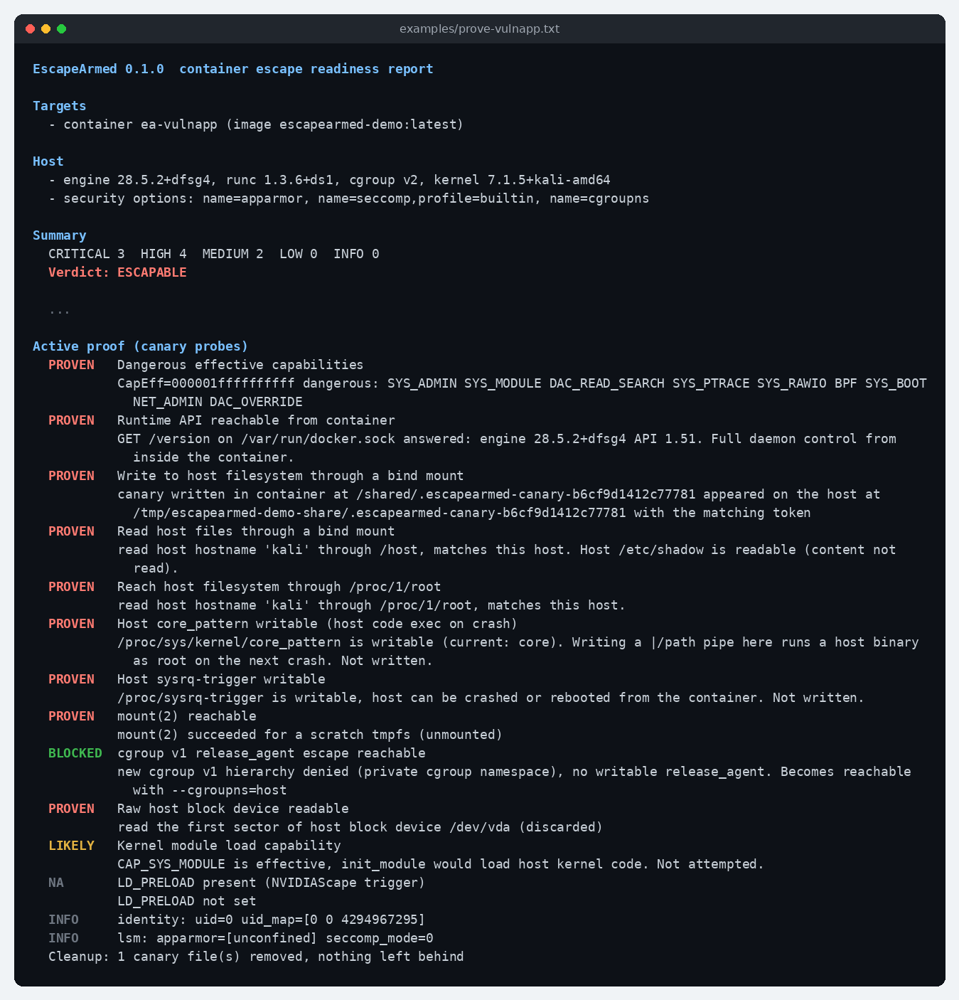
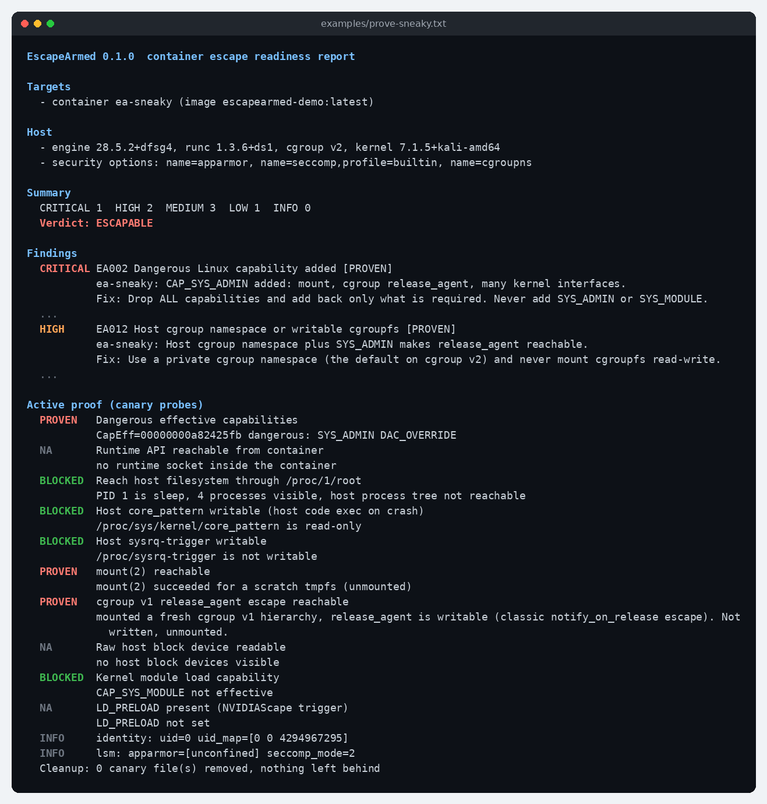
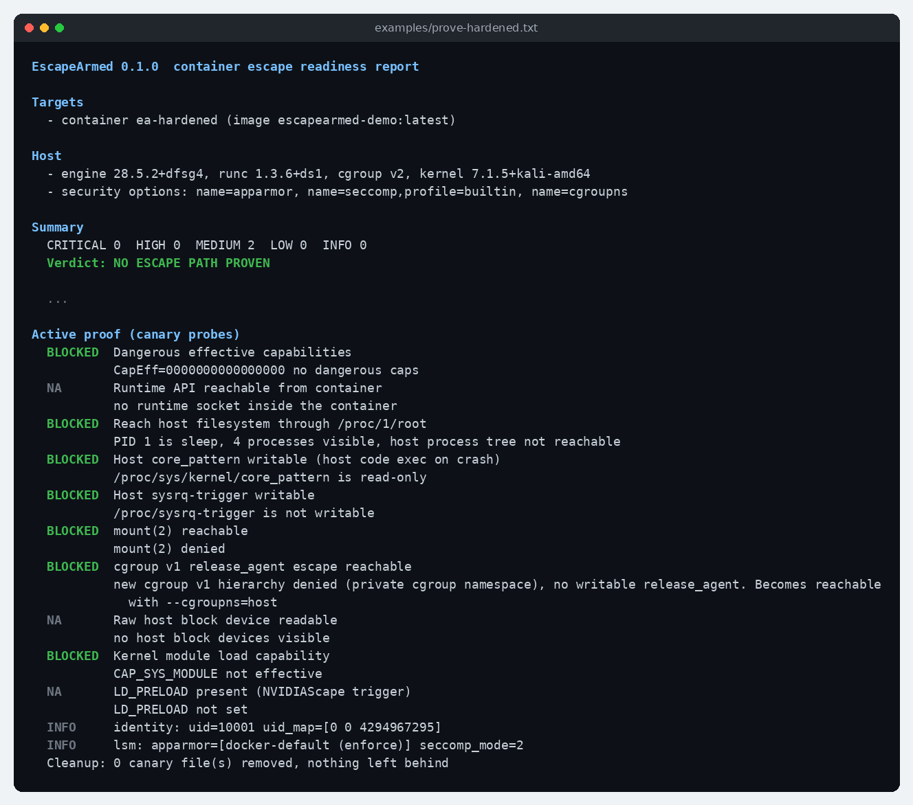
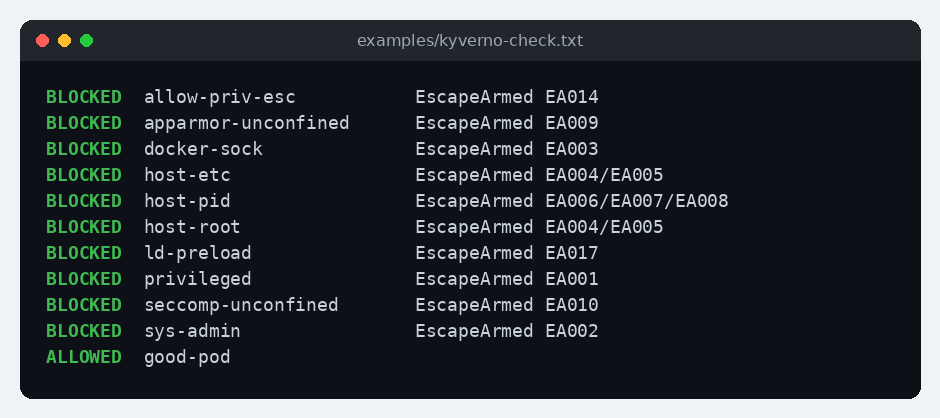
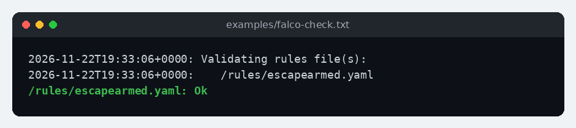

# EscapeArmed Demo Security Assessment Report

| Field | Value |
|---|---|
| **Report** | Container escape readiness assessment, demo lab |
| **Tool** | EscapeArmed 0.1.0 |
| **Date** | 2026-11-22 |
| **Assessor** | EscapeArmed demo run on Kali Linux (`demo/run-demo.sh`) |
| **Classification** | Demo lab. Deliberately vulnerable targets, no production systems |
| **Targets** | `ea-vulnapp`, `ea-sneaky`, `ea-hardened` (image `escapearmed-demo:latest`) |

Back to the [README](../README.md). All evidence below is quoted from the saved run in [`examples/`](../examples/).

## 1. Executive Summary

Three containers were built from the same plain Debian image and run with different settings. Each was scanned statically and then tested with EscapeArmed's active canary probes.

| Target | Configuration | Verdict | Findings (C / H / M / L) |
|---|---|---|---|
| `ea-vulnapp` | Privileged, host PID, SYS_ADMIN, Docker socket, host `/` read-only, writable host directory | **ESCAPABLE** | 3 / 4 / 2 / 0 |
| `ea-sneaky` | Not privileged. SYS_ADMIN, AppArmor unconfined, host cgroup namespace | **ESCAPABLE** | 1 / 2 / 3 / 1 |
| `ea-hardened` | UID 10001, all capabilities dropped, read-only root, no-new-privileges | **NO ESCAPE PATH PROVEN** | 0 / 0 / 2 / 0 |

**Key takeaways**

- `ea-vulnapp` has at least six independent, proven routes to the host, including full Docker API control and host file read and write.
- `ea-sneaky` looks moderate on paper (no privileged flag, no socket, no host mounts), but the cgroup v1 `release_agent` escape was proven reachable. A configuration-only review would likely rate it lower than it deserves.
- `ea-hardened` blocked every probe. Its only findings are host-level (the Docker socket group and no user namespace remapping), which apply to every container on this host.
- The host runs runc 1.3.6, which includes the fixes for CVE-2025-31133, CVE-2025-52565 and CVE-2025-52881, so no vulnerable runc finding (EA015) was raised.

## 2. Scope and Methodology

**In scope**

- Three running containers on the Kali VM Docker host.
- The demo compose file, the demo image, two Dockerfile fixtures (`Dockerfile.nvidiascape`, `Dockerfile.runcrace`) and the host itself.

**Method**

1. **Static scan.** `escapearmed scan` on the compose file, image, Dockerfiles and host, using the 25 rule catalog.
2. **Active proof.** `escapearmed prove <container> --active --i-understand --yes` on each container. Probes ran as the container's configured user.
3. **Policy generation.** Kyverno and Falco artifacts generated from each target's findings.
4. **Policy validation.** Generated policy checked with the Kyverno CLI and Falco's rule validator.
5. **Cleanup check.** The host was checked for leftover canary files and scratch mounts.

**Safety constraints of prove mode**

- Nothing was written to `core_pattern`, `sysrq-trigger`, `release_agent`, `binfmt_misc` or kernel modules. Those checks test write access only.
- The Docker socket check sent one read-only `GET /version`. No containers were created through it.
- The only write was one canary file per writable host bind mount, with a random token. It was verified on the host and removed.
- Scratch mounts (a 1 MB tmpfs and an empty named cgroup v1 hierarchy) were unmounted immediately.
- Raw disk access was tested by reading 512 bytes into `/dev/null`.
- `/etc/shadow` was tested for readability only. Its contents were not read.

## 3. Environment

From [`examples/scan-host.txt`](../examples/scan-host.txt):

```text
Host
  - engine 28.5.2+dfsg4, runc 1.3.6+ds1, cgroup v2, kernel 7.1.5+kali-amd64
  - security options: name=apparmor, name=seccomp,profile=builtin, name=cgroupns
```

- **OS:** Kali Linux Rolling 2026.3 (VM), hostname `kali`.
- **Container engine:** Docker 28.5.2, rootful, no userns-remap.
- **Low level runtime:** runc 1.3.6 (patched for the November 2025 runc CVEs).
- **cgroups:** v2, with kernel support for cgroup v1 hierarchies still present.
- **Confinement:** AppArmor and the builtin seccomp profile enabled by default.

## 4. Findings Summary

| # | Severity | Rule | Target | Status | Title |
|---|---|---|---|---|---|
| F-01 | Critical | EA003 | ea-vulnapp | PROVEN | Container runtime socket mounted |
| F-02 | Critical | EA001 | ea-vulnapp | PROVEN | Privileged container |
| F-03 | Critical | EA002 | ea-vulnapp | PROVEN | Dangerous Linux capability added (SYS_ADMIN) |
| F-04 | High | EA004 | ea-vulnapp | PROVEN | Host root filesystem mounted |
| F-05 | High | EA006 | ea-vulnapp | PROVEN | Host PID namespace shared |
| F-06 | High | EA025 | ea-vulnapp | PROVEN | Writable host bind mount |
| F-07 | High | EA013 | ea-vulnapp | Static | Root in container without user namespace |
| F-08 | Critical | EA002 | ea-sneaky | PROVEN | Dangerous Linux capability added (SYS_ADMIN) |
| F-09 | High | EA012 | ea-sneaky | PROVEN | Host cgroup namespace (release_agent reachable) |
| F-10 | High | EA009 | ea-sneaky | Static | AppArmor disabled (unconfined) |
| F-11 | Medium | EA013 | ea-sneaky | Static | Root in container without user namespace |
| F-12 | Low | EA014 | ea-sneaky | Static | no-new-privileges not set |
| F-13 | Medium | EA023 | host (all targets) | Static | Docker socket writable by group `docker` |
| F-14 | Medium | EA024 | host (all targets) | Static | Daemon has no user namespace isolation |

**Status key**

- **PROVEN:** an active probe confirmed the escape step works on this host.
- **Static:** detected from configuration. No probe directly confirms or rules it out.

## 5. Detailed Findings

### ea-vulnapp

<p align="center"></p>
<p align="center"><b>Figure 1. ea-vulnapp prove report: verdict ESCAPABLE with multiple PROVEN escape paths (prove-vulnapp.txt)</b></p>

**F-01 Container runtime socket mounted (Critical, PROVEN)**

- **Evidence:**
  ```text
  CRITICAL EA003 Container runtime socket mounted [PROVEN]
           ea-vulnapp: Runtime socket /var/run/docker.sock mounted at /var/run/docker.sock (read-write).
  PROVEN   Runtime API reachable from container
           GET /version on /var/run/docker.sock answered: engine 28.5.2+dfsg4 API 1.51. Full daemon control from inside the container.
  ```
- **Impact:** anyone with code execution in the container controls the Docker daemon and can start a new privileged container with the host root mounted. This is the primitive abused in Docker API cryptojacking campaigns.
- **Remediation:** remove the socket mount. Use a scoped API proxy or a dedicated build service.

**F-02 Privileged container (Critical, PROVEN)**

- **Evidence:**
  ```text
  PROVEN   Host core_pattern writable (host code exec on crash)
           /proc/sys/kernel/core_pattern is writable (current: core). Writing a |/path pipe here runs a host binary as root on the next crash. Not written.
  PROVEN   Host sysrq-trigger writable
           /proc/sysrq-trigger is writable, host can be crashed or rebooted from the container. Not written.
  PROVEN   Raw host block device readable
           read the first sector of host block device /dev/vda (discarded)
  INFO     lsm: apparmor=[unconfined] seccomp_mode=0
  ```
- **CVE context:** writable `core_pattern` is the end goal of CVE-2025-31133 style escapes, and `sysrq-trigger` is a target named in CVE-2025-52881. Privileged mode hands an attacker these directly, with no race needed.
- **Impact:** host code execution as root via `core_pattern`, host denial of service via sysrq, and raw read access to the host disk.
- **Remediation:** remove `--privileged`. Grant only the specific capability or device the workload needs.

**F-03 Dangerous Linux capability added (Critical, PROVEN)**

- **Evidence:**
  ```text
  PROVEN   Dangerous effective capabilities
           CapEff=000001ffffffffff dangerous: SYS_ADMIN SYS_MODULE DAC_READ_SEARCH SYS_PTRACE SYS_RAWIO BPF SYS_BOOT NET_ADMIN DAC_OVERRIDE
  PROVEN   mount(2) reachable
           mount(2) succeeded for a scratch tmpfs (unmounted)
  LIKELY   Kernel module load capability
           CAP_SYS_MODULE is effective, init_module would load host kernel code. Not attempted.
  ```
- **Impact:** mount, kernel module load, `open_by_handle_at` file reads and process injection are all available.
- **Remediation:** drop ALL capabilities and add back only what is required.

**F-04 Host root filesystem mounted (High, PROVEN)**

- **Evidence:**
  ```text
  HIGH     EA004 Host root filesystem mounted [PROVEN]
           ea-vulnapp: Host / mounted at /host (read-only).
  PROVEN   Read host files through a bind mount
           read host hostname 'kali' through /host, matches this host. Host /etc/shadow is readable (content not read).
  ```
- **Impact:** host credentials, keys and configuration are readable. Read-only does not prevent credential theft.
- **Remediation:** mount only the exact host directory the workload needs.

**F-05 Host PID namespace shared (High, PROVEN)**

- **Evidence:**
  ```text
  PROVEN   Reach host filesystem through /proc/1/root
           read host hostname 'kali' through /proc/1/root, matches this host.
  ```
- **Impact:** the host filesystem is reachable through host init's root, and with the capabilities in F-03 the container can enter host namespaces.
- **Remediation:** remove `pid: host`.

**F-06 Writable host bind mount (High, PROVEN)**

- **Evidence:**
  ```text
  PROVEN   Write to host filesystem through a bind mount
           canary written in container at /shared/.escapearmed-canary-b6cf9d1412c77781 appeared on the host at /tmp/escapearmed-demo-share/.escapearmed-canary-b6cf9d1412c77781 with the matching token
  ```
- **Note:** the static severity was medium. It was raised to high because the write was proven on the host.
- **Impact:** files written in the container land on the host, a persistence and tampering path.
- **Remediation:** mount host paths read-only, or use a named volume.

**F-07 Root in container without user namespace (High, Static)**

- **Evidence:** `ea-vulnapp: Process runs as UID 0.` and `INFO identity: uid=0 uid_map=[0 0 4294967295]`.
- **CVE context:** user namespaces are the main mitigation for CVE-2025-31133, CVE-2025-52565 and CVE-2025-52881.
- **Remediation:** run as a non-root user and enable user namespaces.

### ea-sneaky

<p align="center"></p>
<p align="center"><b>Figure 2. ea-sneaky prove report: cgroup v1 release_agent escape PROVEN without privileged mode (prove-sneaky.txt)</b></p>

**F-08 and F-09 SYS_ADMIN with host cgroup namespace (Critical and High, PROVEN)**

- **Evidence:**
  ```text
  CRITICAL EA002 Dangerous Linux capability added [PROVEN]
           ea-sneaky: CAP_SYS_ADMIN added: mount, cgroup release_agent, many kernel interfaces.
  HIGH     EA012 Host cgroup namespace or writable cgroupfs [PROVEN]
           ea-sneaky: Host cgroup namespace plus SYS_ADMIN makes release_agent reachable.
  PROVEN   Dangerous effective capabilities
           CapEff=00000000a82425fb dangerous: SYS_ADMIN DAC_OVERRIDE
  PROVEN   mount(2) reachable
           mount(2) succeeded for a scratch tmpfs (unmounted)
  PROVEN   cgroup v1 release_agent escape reachable
           mounted a fresh cgroup v1 hierarchy, release_agent is writable (classic notify_on_release escape). Not written, unmounted.
  ```
- **Why this matters:** the container is not privileged, has no socket and no host mounts. The escape comes from a combination of three settings that each look moderate on their own.
- **Contrast:** in `ea-vulnapp`, which uses a private cgroup namespace, the same probe was blocked: `new cgroup v1 hierarchy denied (private cgroup namespace)`.
- **Impact:** a process in the container can set `release_agent` to a host path and get it executed as root on the host.
- **Remediation:** remove SYS_ADMIN, keep the default private cgroup namespace, and keep AppArmor enabled.

**F-10 AppArmor disabled (High, Static)**

- **Evidence:** `INFO lsm: apparmor=[unconfined] seccomp_mode=2`.
- **CVE context:** CVE-2025-52881 shows LSM labels alone can be bypassed, but the default AppArmor profile still denies the mount used in F-09.
- **Remediation:** use the `docker-default` profile.

**F-11 Root without user namespace (Medium, Static)** and **F-12 no-new-privileges not set (Low, Static)**

- **Evidence:** `ea-sneaky: Process runs as UID 0.` and `ea-sneaky: no-new-privileges is not set.`
- **Remediation:** run as non-root, set `no-new-privileges:true`.

### ea-hardened

<p align="center"></p>
<p align="center"><b>Figure 3. ea-hardened prove report: every probe BLOCKED or NA, verdict NO ESCAPE PATH PROVEN (prove-hardened.txt)</b></p>

**No container-level findings.**

- **Evidence:**
  ```text
  BLOCKED  Dangerous effective capabilities
           CapEff=0000000000000000 no dangerous caps
  NA       Runtime API reachable from container
           no runtime socket inside the container
  BLOCKED  Host core_pattern writable (host code exec on crash)
           /proc/sys/kernel/core_pattern is read-only
  BLOCKED  mount(2) reachable
           mount(2) denied
  BLOCKED  cgroup v1 release_agent escape reachable
  INFO     identity: uid=10001 uid_map=[0 0 4294967295]
  INFO     lsm: apparmor=[docker-default (enforce)] seccomp_mode=2
  ```
- Every probe returned BLOCKED or NA. This is the baseline the other two containers should be brought to.

### Host findings (affect all targets)

**F-13 Docker socket writable by group docker (Medium, Static)**

- **Evidence:** `kali: /var/run/docker.sock is writable by group docker (op2rfrc8). Each member is effectively root.`
- **Remediation:** audit the docker group membership, or use rootless Docker.

**F-14 Daemon has no user namespace isolation (Medium, Static)**

- **Evidence:** `kali: Docker daemon runs rootful without userns-remap.`
- **CVE context:** without user namespaces, container root is host root, which is what the November 2025 runc escapes rely on.
- **Remediation:** enable `userns-remap`, or run rootless Docker.

### Supporting static scans

- **Dockerfile fixtures** ([`scan-dockerfiles.txt`](../examples/scan-dockerfiles.txt)): `Dockerfile.nvidiascape` raised EA017 critical, `LD_PRELOAD='/proc/self/cwd/poc.so' is set on a GPU workload, the exact NVIDIAScape trigger` (CVE-2025-23266). `Dockerfile.runcrace` raised EA020 high for replacing `/dev/null` with a link to `core_pattern` (CVE-2025-31133, CVE-2025-52565) and EA021 high for `RUN --security=insecure`.
- **Demo image** ([`scan-image.txt`](../examples/scan-image.txt)): only EA013 medium (no USER instruction). The layer walk found no `/dev` or procfs symlinks.
- **Host** ([`scan-host.txt`](../examples/scan-host.txt)): EA023 and EA024 only. No runc or NVIDIA toolkit CVE finding.

## 6. Policy Validation Results

**Kyverno** (Kyverno CLI v1.20.0, [`kyverno-check.txt`](../examples/kyverno-check.txt)): 10 violation pods blocked, 1 hardened pod allowed.

```text
BLOCKED  allow-priv-esc           EscapeArmed EA014
BLOCKED  apparmor-unconfined      EscapeArmed EA009
BLOCKED  docker-sock              EscapeArmed EA003
BLOCKED  host-etc                 EscapeArmed EA004/EA005
BLOCKED  host-pid                 EscapeArmed EA006/EA007/EA008
BLOCKED  host-root                EscapeArmed EA004/EA005
BLOCKED  ld-preload               EscapeArmed EA017
BLOCKED  privileged               EscapeArmed EA001
BLOCKED  seccomp-unconfined       EscapeArmed EA010
BLOCKED  sys-admin                EscapeArmed EA002
ALLOWED  good-pod
```

<p align="center"></p>
<p align="center"><b>Figure 4. Kyverno CLI result: 10 violation pods blocked, 1 hardened pod allowed (kyverno-check.txt)</b></p>

**Falco** (`falco -V` on falcosecurity/falco:0.45.2, [`falco-check.txt`](../examples/falco-check.txt)):

```text
/rules/escapearmed.yaml: Ok
```

<p align="center"></p>
<p align="center"><b>Figure 5. Falco validator accepts the generated rules file (falco-check.txt)</b></p>

## 7. Cleanup Verification

From [`cleanup-check.txt`](../examples/cleanup-check.txt) and the prove reports:

```text
no canary files left in /tmp/escapearmed-demo-share
no escapearmed mounts left on the host
```

- `ea-vulnapp`: `Cleanup: 1 canary file(s) removed, nothing left behind`.
- `ea-sneaky` and `ea-hardened`: `Cleanup: 0 canary file(s) removed, nothing left behind` (no writable host mounts).
- The demo containers were removed at the end of the run.

## 8. Limitations

- This is a lab assessment of three deliberately configured containers, not a production environment.
- The runc race CVEs were not executed. The host runc is patched, and EscapeArmed reports the setup and missing mitigations rather than running the race.
- Probes that could cause harm were not completed by design. `core_pattern`, `sysrq-trigger` and `release_agent` were shown writable but not written, and module loading is reported as LIKELY.
- Write access tests on procfs reflect `access(2)` and may not capture every LSM decision made at open time.
- No GPU or NVIDIA Container Toolkit was present, so NVIDIAScape was covered by static Dockerfile analysis only.
- Falco rules were validated for syntax and fields, not replayed against live events.
- The VM ran under software emulation, which affects speed but not results.

## 9. Appendix: Raw Artifacts

**Active proof reports**

- [`examples/prove-vulnapp.txt`](../examples/prove-vulnapp.txt)
- [`examples/prove-sneaky.txt`](../examples/prove-sneaky.txt)
- [`examples/prove-hardened.txt`](../examples/prove-hardened.txt)

**Per target artifacts** (report, JSON, SARIF, Kyverno, Falco)

- `ea-vulnapp`: [report.txt](../examples/vulnapp/report.txt), [report.json](../examples/vulnapp/report.json), [escapearmed.sarif](../examples/vulnapp/escapearmed.sarif), [kyverno-policy.yaml](../examples/vulnapp/kyverno-policy.yaml), [falco-rules.yaml](../examples/vulnapp/falco-rules.yaml)
- `ea-sneaky`: [report.txt](../examples/sneaky/report.txt), [report.json](../examples/sneaky/report.json), [escapearmed.sarif](../examples/sneaky/escapearmed.sarif), [kyverno-policy.yaml](../examples/sneaky/kyverno-policy.yaml), [falco-rules.yaml](../examples/sneaky/falco-rules.yaml)
- `ea-hardened`: [report.txt](../examples/hardened/report.txt), [report.json](../examples/hardened/report.json), [escapearmed.sarif](../examples/hardened/escapearmed.sarif), [kyverno-policy.yaml](../examples/hardened/kyverno-policy.yaml), [falco-rules.yaml](../examples/hardened/falco-rules.yaml)

**Static scans**

- [`examples/scan-compose.txt`](../examples/scan-compose.txt) and [`examples/scan-compose.sarif`](../examples/scan-compose.sarif)
- [`examples/scan-dockerfiles.txt`](../examples/scan-dockerfiles.txt)
- [`examples/scan-image.txt`](../examples/scan-image.txt)
- [`examples/scan-host.txt`](../examples/scan-host.txt)

**Validation and run logs**

- [`examples/kyverno-check.txt`](../examples/kyverno-check.txt), [`examples/falco-check.txt`](../examples/falco-check.txt), [`examples/pytest.txt`](../examples/pytest.txt)
- [`examples/cleanup-check.txt`](../examples/cleanup-check.txt), [`examples/demo-run.log`](../examples/demo-run.log)
