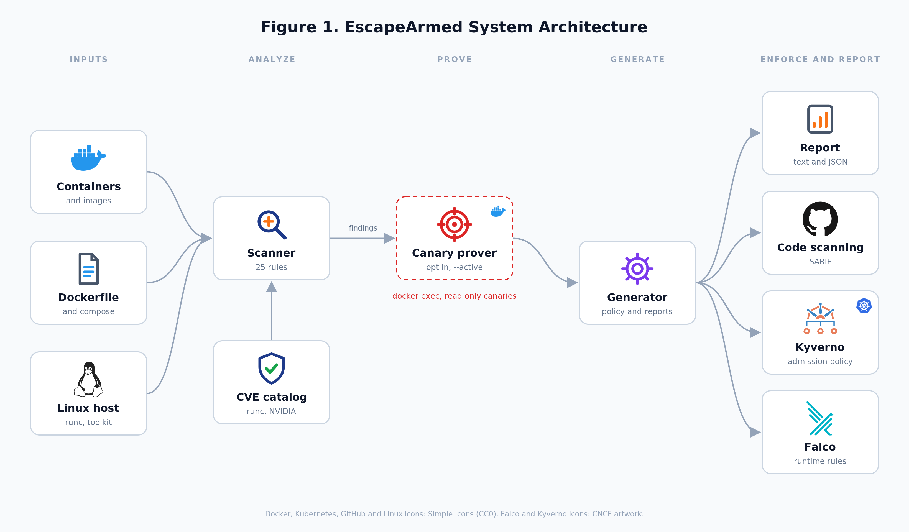

# EscapeArmed Technical Documentation

This document covers how EscapeArmed works inside: the data model, every rule and why it exists, the probe design and its safety guarantees, the output formats, limitations and testing.

Back to the [README](../README.md).

## Contents

1. Architecture internals
2. Workload model
3. Sources
4. Analyzer and host checks
5. Rule reference
6. CVE mapping
7. Active prover
8. Safety guarantees
9. Output formats
10. Generated policy
11. Exit codes
12. Limitations
13. Testing

## 1. Architecture Internals



| Module | Role |
|---|---|
| `escapearmed/cli.py` | Command line: `scan`, `prove`, `gen-policy`, `rules`, output handling, exit codes |
| `escapearmed/docker.py` | Thin wrapper over the `docker` CLI (inspect, info, exec, save). Works with any context or `DOCKER_HOST` |
| `escapearmed/sources/inspect.py` | Containers and image config to the workload model |
| `escapearmed/sources/layers.py` | Saves an image and walks every layer tar for symlinks and device nodes |
| `escapearmed/sources/dockerfile.py` | Dockerfile parser (continuations, stages, ENV forms, RUN flags) |
| `escapearmed/sources/compose.py` | Compose parser with per field and per volume line numbers |
| `escapearmed/hostfacts.py` | Engine info, runc and NVIDIA toolkit versions, toolkit config, socket mode and group |
| `escapearmed/catalog.py` | Rule and CVE catalog, dangerous capability table, socket and sensitive path lists |
| `escapearmed/analyzer.py` | Rules applied to workloads and host facts, version range logic |
| `escapearmed/probe.sh` | In-container probe, POSIX sh |
| `escapearmed/prover.py` | Runs the probe, verifies canaries from the host, cleans up, computes the verdict |
| `escapearmed/report.py` | Text and JSON reports |
| `escapearmed/generators/` | SARIF, Kyverno and Falco generators |

**Design choices**

- The Docker CLI is used instead of an SDK so the tool has one dependency and honors every Docker context.
- Every source becomes the same model, so one rule set covers live containers, images and files.
- The probe is shell, not a binary, so it runs in almost any image without copying files in.
- Proof is kept separate from detection. A static finding is always reported, and proof only adds evidence to it.

## 2. Workload Model

`ContainerSpec` (in `escapearmed/models.py`) holds:

- Identity: `name`, `source_type` (container, image, dockerfile, compose), `source_ref`, `image`.
- Privilege: `privileged`, `cap_add`, `cap_drop`, `user`, `readonly_rootfs`.
- Mounts: list of `Mount(source, target, read_only, type)`. Only `bind` mounts with absolute sources count as host paths.
- Namespaces: `pid_mode`, `network_mode`, `ipc_mode`, `uts_mode`, `userns_mode`, `cgroupns_mode`.
- Confinement: `security_opt`, `apparmor_profile`.
- Devices and GPU: `devices`, `runtime`, `gpu_requested`.
- Environment: `env`.
- Extras: Dockerfile RUN steps, stage list, layer hits, and a `lines` map used for SARIF locations.

`Finding` holds the rule id, title, severity, target, detail, CVEs, remediation, evidence, file and line, and a `proof` field (NOT_TESTED, PROVEN, LIKELY or BLOCKED).

## 3. Sources

**Containers**

- `docker container inspect` gives HostConfig (privileged, caps, namespaces, security options, devices, runtime, device requests) and the real mount list.
- GPU use is detected from NVIDIA device requests, an `nvidia` runtime, or a non-void `NVIDIA_VISIBLE_DEVICES`.

**Images**

- `docker image inspect` gives the default user, environment, labels and volumes.
- The layer walk runs `docker image save`, reads `manifest.json`, and opens each layer tar. It flags symlinks at `/dev` paths (`null`, `console`, `pts`, `ptmx` and others), any symlink pointing into `/proc`, and character or block device nodes.

**Dockerfiles**

- Backslash continuations are joined and the first physical line is kept for reporting.
- `FROM` starts a new stage and resets `USER`.
- `ENV` supports both `KEY=value` and the legacy `KEY value` form.
- `RUN` is checked for `--security=insecure` and for `/dev` or `/proc` tampering (symlinks over `/dev/null`, `/dev/console`, `/dev/pts`, removing `/dev/null`, links into `/proc`, `mknod`).
- CUDA or `nvidia/` base images, `com.nvidia` labels and `NVIDIA_VISIBLE_DEVICES` mark a GPU workload.

**Compose**

- Supports short and long volume syntax, list and map `environment`, `cap_add`, `cap_drop`, `pid`, `network_mode`, `ipc`, `security_opt`, `devices`, `user`, `runtime`, `userns_mode`, `cgroup`, `read_only` and GPU reservations under `deploy.resources.reservations.devices`.
- Each field and each volume entry gets its own line number.

## 4. Analyzer and Host Checks

**Workload checks** apply rules EA001 to EA014, EA017 to EA022 and EA025 to each workload.

- AppArmor and seccomp findings are suppressed for privileged containers, because EA001 already covers them.
- A read-only host root mount is high, a writable one is critical.
- Sensitive host paths are high when writable and medium when read-only.
- A runtime socket is critical even when mounted read-only, because the API stays fully usable.
- `LD_PRELOAD` is critical on a GPU workload and high otherwise.

**Host checks** apply EA015, EA016, EA023 and EA024.

- runc is affected below 1.2.8, from 1.3.0 to 1.3.2, and on 1.4.0-rc.1 and rc.2.
- The NVIDIA Container Toolkit is affected below 1.17.8. If `disable-cuda-compat-lib-hook = true` is set in the toolkit config, the finding drops to high and is marked as partially mitigated.
- No `userns` or `rootless` in the daemon security options gives EA024.
- A world writable Docker socket is critical. A group writable socket with group members is medium and lists the members.

## 5. Rule Reference

**Dangerous capabilities (EA002)**

| Capability | Severity | Why |
|---|---|---|
| SYS_ADMIN | critical | mount, cgroup release_agent, many kernel interfaces |
| SYS_MODULE | critical | load a kernel module and run code in ring 0 |
| DAC_READ_SEARCH | high | open_by_handle_at host file read (the Shocker exploit) |
| SYS_PTRACE | high | inject into processes, combined with host PID it reaches host processes |
| SYS_RAWIO | high | raw IO ports and /dev/mem style access |
| BPF | high | load eBPF programs that can read kernel memory |
| SYS_BOOT | high | reboot or kexec the host |
| PERFMON | medium | perf events that leak kernel data |
| DAC_OVERRIDE | medium | bypass file permission checks on mounted host paths |
| NET_ADMIN | medium | reconfigure networking, sniff or redirect traffic |
| SYSLOG | low | read kernel log, leak kernel pointers |
| MKNOD | low | create device nodes |
| ALL | critical | every capability |

**EA001 Privileged container** (critical)

- Why: --privileged disables almost every isolation boundary: all capabilities, all host devices, writable /proc/sys and /sys, no seccomp and no AppArmor. Host escape is a few shell commands away (core_pattern, cgroup release_agent, raw disk mount).
- Fix: Remove privileged mode. Grant only the specific capability or device the workload needs.
- CVEs: CVE-2025-31133, CVE-2025-52565, CVE-2025-52881
- Kyverno control: privileged
- Falco rules: core_pattern_write, release_agent_write, container_mount, sysrq_write

**EA002 Dangerous Linux capability added** (high)

- Why: Capabilities such as SYS_ADMIN, SYS_MODULE, DAC_READ_SEARCH, SYS_PTRACE, SYS_RAWIO and BPF each enable a known escape path (mounting, kernel module load, open_by_handle_at, process injection, raw IO, eBPF).
- Fix: Drop ALL capabilities and add back only what is required. Never add SYS_ADMIN or SYS_MODULE.
- CVEs: none
- Kyverno control: capabilities
- Falco rules: container_mount, kernel_module_load

**EA003 Container runtime socket mounted** (critical)

- Why: A mounted docker.sock, containerd.sock or crio.sock gives full control of the runtime. Anyone in the container can start a new privileged container with the host root mounted. This is the primitive abused by Docker API cryptojacking campaigns.
- Fix: Do not mount runtime sockets. Use a scoped API proxy or a dedicated build service instead.
- CVEs: none
- Kyverno control: runtime_socket
- Falco rules: runtime_socket_access

**EA004 Host root filesystem mounted** (critical)

- Why: The host / is bind mounted into the container. Writing to it is equivalent to root on the host.
- Fix: Mount only the exact host directory the workload needs, read-only where possible.
- CVEs: none
- Kyverno control: host_path
- Falco rules: host_sensitive_write

**EA005 Sensitive host path mounted** (high)

- Why: Host /proc, /sys, /etc, /dev, /root, /boot, /lib/modules, /var/lib/docker or similar is mounted. These expose kernel knobs, credentials or other containers' filesystems.
- Fix: Remove the hostPath mount or replace it with a projected volume or a narrow read-only path.
- CVEs: none
- Kyverno control: host_path
- Falco rules: host_sensitive_write

**EA006 Host PID namespace shared** (high)

- Why: With the host PID namespace the container sees every host process and can reach host filesystems through /proc/<pid>/root, or inject into processes with ptrace.
- Fix: Remove pid: host / hostPID: true.
- CVEs: none
- Kyverno control: host_namespaces
- Falco rules: proc_root_access

**EA007 Host network namespace shared** (medium)

- Why: The container shares the host network stack and can reach services bound to localhost on the host, including unauthenticated runtime or kubelet APIs.
- Fix: Remove network_mode: host / hostNetwork: true.
- CVEs: none
- Kyverno control: host_namespaces
- Falco rules: none

**EA008 Host IPC namespace shared** (medium)

- Why: Shared host IPC exposes host shared memory segments and semaphores.
- Fix: Remove ipc: host / hostIPC: true.
- CVEs: none
- Kyverno control: host_namespaces
- Falco rules: none

**EA009 AppArmor disabled (unconfined)** (high)

- Why: Without AppArmor the container loses the default deny rules for mount, /proc/sys writes and other escape steps. Note that CVE-2025-52881 shows LSM labels alone are not enough.
- Fix: Use the default docker-default or runtime/default AppArmor profile.
- CVEs: CVE-2025-52881
- Kyverno control: apparmor
- Falco rules: none

**EA010 Seccomp disabled (unconfined)** (high)

- Why: Without seccomp, syscalls such as mount, unshare, keyctl, bpf, open_by_handle_at and init_module are reachable from the container.
- Fix: Use the RuntimeDefault seccomp profile or a stricter custom profile.
- CVEs: none
- Kyverno control: seccomp
- Falco rules: container_mount

**EA011 Host device exposed** (high)

- Why: Host block or character devices are passed through. Raw disk access lets a container read or modify the host filesystem directly.
- Fix: Remove the device mapping. Use a device plugin with a narrow device if hardware is required.
- CVEs: none
- Kyverno control: privileged
- Falco rules: raw_disk_read

**EA012 Host cgroup namespace or writable cgroupfs** (medium)

- Why: A host cgroup namespace or writable /sys/fs/cgroup makes the cgroup v1 release_agent escape reachable when combined with SYS_ADMIN.
- Fix: Use a private cgroup namespace (the default on cgroup v2) and never mount cgroupfs read-write.
- CVEs: none
- Kyverno control: none
- Falco rules: release_agent_write

**EA013 Root in container without user namespace** (medium)

- Why: UID 0 in the container is UID 0 on the host. User namespaces (rootless or userns-remap) are the main mitigation for the November 2025 runc escapes because the remapped root cannot write host procfs files.
- Fix: Run as a non-root USER, and enable user namespaces (rootless Docker, userns-remap, or Kubernetes hostUsers: false).
- CVEs: CVE-2025-31133, CVE-2025-52565, CVE-2025-52881
- Kyverno control: run_as_non_root
- Falco rules: none

**EA014 no-new-privileges not set** (low)

- Why: Setuid binaries inside the container can still raise privileges.
- Fix: Set security_opt: no-new-privileges:true or allowPrivilegeEscalation: false.
- CVEs: none
- Kyverno control: privilege_escalation
- Falco rules: none

**EA015 runc vulnerable to November 2025 escapes** (critical)

- Why: The host runc version is older than the fixed releases for CVE-2025-31133, CVE-2025-52565 and CVE-2025-52881. A malicious image or container config can escape.
- Fix: Upgrade runc to 1.2.8, 1.3.3, 1.4.0-rc.3 or later and enable user namespaces.
- CVEs: CVE-2025-31133, CVE-2025-52565, CVE-2025-52881
- Kyverno control: none
- Falco rules: core_pattern_write, sysrq_write

**EA016 NVIDIA Container Toolkit vulnerable to NVIDIAScape** (critical)

- Why: The NVIDIA Container Toolkit on this host is older than 1.17.8. Any image that sets LD_PRELOAD can take over the host through the createContainer hook.
- Fix: Upgrade to NVIDIA Container Toolkit 1.17.8 or later. As a stopgap set features.disable-cuda-compat-lib-hook = true in /etc/nvidia-container-runtime/config.toml.
- CVEs: CVE-2025-23266
- Kyverno control: none
- Falco rules: nvidia_hook_preload

**EA017 LD_PRELOAD set in image or container environment** (high)

- Why: LD_PRELOAD in an image ENV is the exact trigger for NVIDIAScape on GPU hosts, and is a strong signal of a weaponized image elsewhere.
- Fix: Remove LD_PRELOAD from the image. Block it in admission policy for GPU workloads.
- CVEs: CVE-2025-23266
- Kyverno control: ld_preload
- Falco rules: nvidia_hook_preload

**EA018 GPU workload on NVIDIA runtime** (info)

- Why: The workload requests NVIDIA GPUs, so the NVIDIA Container Toolkit hooks run for it on the host.
- Fix: Keep the toolkit patched (>= 1.17.8) and only allow trusted images on GPU nodes.
- CVEs: CVE-2025-23266
- Kyverno control: none
- Falco rules: none

**EA019 Image ships device or procfs symlinks** (critical)

- Why: The image filesystem contains a symlink at a /dev path or a symlink that points into /proc. This is the setup step for the runc mount races (CVE-2025-31133, CVE-2025-52565).
- Fix: Do not run this image. Rebuild from a trusted base and upgrade runc.
- CVEs: CVE-2025-31133, CVE-2025-52565
- Kyverno control: none
- Falco rules: none

**EA020 Build step tampers with /dev or /proc** (high)

- Why: A RUN instruction creates or replaces entries under /dev or links into /proc. Legit images almost never do this. It matches the runc mount race setup.
- Fix: Remove the instruction. Review where this Dockerfile came from.
- CVEs: CVE-2025-31133, CVE-2025-52565
- Kyverno control: none
- Falco rules: none

**EA021 Insecure BuildKit entitlement** (high)

- Why: RUN --security=insecure runs the build step fully privileged on the build host. Any build service that accepts untrusted Dockerfiles can be escaped this way.
- Fix: Remove --security=insecure and do not grant the security.insecure entitlement to builders.
- CVEs: none
- Kyverno control: none
- Falco rules: none

**EA022 User namespace explicitly disabled** (medium)

- Why: userns_mode: host opts this container out of daemon user namespace remapping.
- Fix: Remove userns_mode: host.
- CVEs: CVE-2025-31133, CVE-2025-52565, CVE-2025-52881
- Kyverno control: none
- Falco rules: none

**EA023 Runtime socket writable by non-root on host** (high)

- Why: The Docker socket on the host is group or world writable. Any member of that group is effectively root.
- Fix: Restrict socket permissions and audit the docker group, or use rootless Docker.
- CVEs: none
- Kyverno control: none
- Falco rules: none

**EA024 Host daemon has no user namespace isolation** (medium)

- Why: The container engine runs rootful without userns-remap, so container root maps to host root for every workload.
- Fix: Enable userns-remap or run rootless Docker or Podman.
- CVEs: CVE-2025-31133, CVE-2025-52565, CVE-2025-52881
- Kyverno control: none
- Falco rules: none

**EA025 Writable host bind mount** (medium)

- Why: A host directory is bind mounted read-write. Anything written in the container lands on the host, which is a persistence and tampering path even when the directory looks harmless.
- Fix: Mount host paths read-only, or use a named volume.
- CVEs: none
- Kyverno control: none
- Falco rules: host_sensitive_write

## 6. CVE Mapping

**CVE-2025-31133 runc maskedPaths /dev/null symlink race**

- A container image or config that swaps /dev/null for a symlink during container creation makes runc bind-mount an attacker chosen procfs file read-write (for example /proc/sys/kernel/core_pattern), which leads to host code execution.
- Fixed in: runc 1.2.8, 1.3.3, 1.4.0-rc.3
- Advisory: https://github.com/opencontainers/runc/security/advisories/GHSA-9493-h29p-rfm2

**CVE-2025-52565 runc /dev/console bind mount race**

- A race on the /dev/console bind mount lets a malicious container redirect the mount to a procfs path and gain write access to host kernel knobs.
- Fixed in: runc 1.2.8, 1.3.3, 1.4.0-rc.3
- Advisory: https://github.com/opencontainers/runc/security/advisories/GHSA-qw9x-cqr3-wc7r

**CVE-2025-52881 runc LSM bypass via misdirected procfs writes**

- Shared mounts and racing symlinks redirect runc's own writes (for example AppArmor labels in /proc/self/attr) to other procfs files such as /proc/sysrq-trigger, bypassing LSM confinement and enabling host DoS or escape.
- Fixed in: runc 1.2.8, 1.3.3, 1.4.0-rc.3
- Advisory: https://github.com/opencontainers/runc/security/advisories/GHSA-cgrx-mc8f-2prm

**CVE-2025-23266 NVIDIAScape, NVIDIA Container Toolkit LD_PRELOAD hook escape**

- The toolkit's createContainer OCI hook inherits environment variables from the container image. An image that sets LD_PRELOAD makes the privileged hook load an attacker library on the host, giving root on the GPU node.
- Fixed in: NVIDIA Container Toolkit 1.17.8, GPU Operator 25.3.2
- Advisory: https://nvidia.custhelp.com/app/answers/detail/a_id/5659

**How EscapeArmed maps them**

- **CVE-2025-31133 and CVE-2025-52565** need a container whose filesystem plants a symlink where runc will bind mount. EscapeArmed flags the setup in image layers (EA019) and Dockerfiles (EA020), the vulnerable runc version (EA015), and the missing mitigation, user namespaces (EA013, EA022, EA024). The prover shows whether the end goal, a writable `core_pattern`, is already reachable.
- **CVE-2025-52881** misdirects runc writes into procfs and bypasses LSM labels. EscapeArmed reports the runc version, AppArmor state (EA009) and whether `/proc/sysrq-trigger` is writable from the container.
- **CVE-2025-23266** is triggered by `LD_PRELOAD` in the image environment on a GPU host. EscapeArmed flags `LD_PRELOAD` (EA017), GPU workloads (EA018) and the toolkit version and hook setting (EA016). Kyverno and Falco output block and detect the trigger.

## 7. Active Prover

**Flow**

1. The CLI checks `--active` and `--i-understand`, prints the warning banner and asks for the container name (or takes `--yes`).
2. The prover inspects the container and builds a plan: writable host mount targets, host root or `/etc` mounts to read from, socket paths, and the cgroup namespace mode.
3. A header with a random 16 hex character token and the plan is prepended to `probe.sh`, and the script is piped into `docker exec -i <container> sh -s`. Without `--as-root` it runs as the container's own user.
4. The probe prints one `EA|probe|STATUS|evidence` line per check.
5. On the host, the prover checks that each canary exists at the mount source with the right token, and compares hostnames read through mounts with the real host name.
6. A second `docker exec` removes the canaries. The report lists what was removed and anything left.
7. Proof results are merged into findings and the verdict is computed.

**Probes**

| Probe | Checks | Confirms rules | CVEs |
|---|---|---|---|
| `runtime_socket` | Runtime API reachable from container | EA003 |   |
| `host_write` | Write to host filesystem through a bind mount | EA025, EA004, EA005 |   |
| `host_read` | Read host files through a bind mount | EA004, EA005 |   |
| `host_pid` | Reach host filesystem through /proc/1/root | EA006 |   |
| `core_pattern` | Host core_pattern writable (host code exec on crash) | EA001 | CVE-2025-31133 |
| `sysrq` | Host sysrq-trigger writable | EA001 | CVE-2025-52881 |
| `mount` | mount(2) reachable | EA001, EA002, EA010 |   |
| `release_agent` | cgroup v1 release_agent escape reachable | EA001, EA002, EA012 |   |
| `raw_disk` | Raw host block device readable | EA001, EA011 |   |
| `kernel_module` | Kernel module load capability | EA002 |   |
| `caps` | Dangerous effective capabilities | EA001, EA002 |   |
| `ld_preload` | LD_PRELOAD present (NVIDIAScape trigger) | EA017 | CVE-2025-23266 |

**Probe details**

- `caps` decodes `CapEff` from `/proc/self/status` and lists effective dangerous capabilities.
- `runtime_socket` deduplicates sockets by real path and sends `GET /version` with curl, perl, python3 or socat, whichever exists. A Docker API answer is PROVEN, a writable socket without a client is LIKELY.
- `host_write` writes `.escapearmed-canary-<token>` into each writable host mount. PROVEN needs the host side file with the same token.
- `host_read` reads the hostname through host root or `/etc` mounts and tests whether `shadow` is readable, without reading it.
- `host_pid` compares mount namespaces of PID 1 and itself and reads `/proc/1/root/etc/hostname`.
- `core_pattern` and `sysrq` use a write access test only.
- `mount` mounts a 1 MB tmpfs in a scratch directory and unmounts it.
- `release_agent` looks for a writable existing `release_agent`, otherwise mounts an empty named cgroup v1 hierarchy, tests `release_agent` for write access, and unmounts. It explains when a private cgroup namespace or missing v1 support blocks it.
- `raw_disk` reads 512 bytes from the first host block device into `/dev/null`.
- `kernel_module` is LIKELY when `CAP_SYS_MODULE` is effective. Nothing is loaded.
- `ld_preload` reports the variable if set.

**Verdict**

- `ESCAPABLE` when any of runtime socket, host write, host read, host PID, core_pattern, release_agent or raw disk is PROVEN.
- `AT RISK` when any other probe is PROVEN or LIKELY.
- `NO ESCAPE PATH PROVEN` otherwise.

## 8. Safety Guarantees

- Two flags plus a typed confirmation are required. Without a terminal, `--yes` is required too.
- No writes to `core_pattern`, `sysrq-trigger`, `release_agent`, `notify_on_release`, `binfmt_misc`, `modprobe` or kernel modules. These are tested with `[ -w ]`, which uses `access(2)` and does not open the file.
- The runtime API call is a single read-only `GET /version`. No containers, images or volumes are created.
- Canary files contain only a marker and the token, and are removed after verification.
- Scratch mounts live under a private `mktemp` directory and an `EXIT INT TERM` trap unmounts and deletes them.
- Disk reads go to `/dev/null`.
- `/etc/shadow` is only tested for readability, never read.
- The demo script checks the host afterwards for leftover canaries and mounts.

## 9. Output Formats

**Text** is grouped into Targets, Host, Summary (with the verdict), Findings, Active proof and CVE context.

**JSON**

```json
{
  "tool": "EscapeArmed",
  "version": "0.1.0",
  "targets": ["container ea-vulnapp (image escapearmed-demo:latest)"],
  "host": {"engine_version": "...", "runc_version": "...", "security_options": []},
  "summary": {"critical": 3, "high": 4, "medium": 2, "low": 0, "info": 0},
  "findings": [{"rule_id": "EA003", "severity": "critical", "proof": "PROVEN", "evidence": {}}],
  "proof": {"verdict": "ESCAPABLE", "results": [], "canaries_cleaned": [], "canaries_left": []}
}
```

**SARIF 2.1.0**

- One rule descriptor per rule used, with help text that includes the fix and CVE links.
- `security-severity`: critical 9.5, high 8.0, medium 5.5, low 3.0, info 1.0.
- Levels: critical and high are `error`, medium is `warning`, low and info are `note`.
- File findings carry the file and line. Container and host findings use `container/<name>` with line 1.

## 10. Generated Policy

**Kyverno**

- Output is `policies.kyverno.io/v1` `ValidatingPolicy` with CEL, because Kyverno 1.20 removed the legacy `ClusterPolicy` engine.
- One `Deny` (or `Audit`) policy matches pods on CREATE and UPDATE, with a variable `allContainers` covering containers, init containers and ephemeral containers.
- Validations are ordered most severe first, since Kyverno reports the first failing validation: privileged, runtime socket, sensitive hostPath, host namespaces, capabilities, `LD_PRELOAD`, AppArmor, seccomp, privilege escalation.
- A second `Audit` policy checks `runAsNonRoot` and `hostUsers: false`, the user namespace mitigation for the runc CVEs.
- Privileged findings also enable the capability, AppArmor and seccomp controls.

**Falco**

- The file declares `required_engine_version` and its own macros (`ea_container`, `ea_open_write`, `ea_open_read`, `ea_spawned_process`), so it loads without the default rules.
- Rules: host kernel hook writes, sysrq-trigger writes, release_agent writes, mount from container, runtime socket connect, `/proc/1/root` access and nsenter, writes through flagged host mounts (paths taken from the findings), raw block device access, kernel module load, and NVIDIA hooks started with `LD_PRELOAD`.
- Every rule is tagged `escapearmed`, `container_escape` and the MITRE technique (T1611 and others).

## 11. Exit Codes

| Code | Meaning |
|---|---|
| 0 | Success, nothing at or above `--fail-on` |
| 2 | A finding at or above `--fail-on` (argument errors also exit 2) |
| 3 | `--fail-on-escape` and the verdict is ESCAPABLE |
| 64 | Missing safety flags, confirmation refused without a terminal, or missing targets |
| 65 | Target container not running |
| 66 | File not found |
| 70 | Docker error |

## 12. Limitations

- Version checks use the upstream version string. Distros that backport fixes may still show as affected.
- The runc races are not executed. EscapeArmed detects the setup and missing mitigations and proves the end goal where reachable.
- containerd and CRI-O sockets are gRPC, so they are reported as LIKELY.
- Host side canary verification needs the scanner on the Docker host. Use `--remote-daemon` otherwise.
- Kubernetes pods are covered by generated policy, not scanned directly. Scanning pod specs is planned.
- Falco rules are validated with `falco -V`, not yet replayed against captured events.
- Write access tests on procfs reflect `access(2)`, which matches the kernel's permission and read-only mount checks but cannot see every LSM decision made at open time.

## 13. Testing

- `pytest -q` runs 24 unit tests: parsers, line numbers, rule logic, runc and toolkit version ranges, host checks, SARIF structure, Kyverno and Falco generation, JSON round trip and probe output interpretation.
- `tests/k8s/check-kyverno.sh` generates the full policy and runs the Kyverno CLI against `tests/k8s/violations/` (each pod breaks one control and must be denied) and `tests/k8s/good-pod.yaml` (must pass).
- `tests/falco/check-falco.sh` generates the full Falco rules and validates them with `falco -V` in the official Falco image.
- `demo/run-demo.sh` is the end to end test against real containers. Its outputs are committed in `examples/`.
- Tested on Kali Linux Rolling 2026.3, kernel 7.1.5, Docker 28.5.2, runc 1.3.6, cgroup v2, Kyverno CLI 1.20.0 and Falco 0.45.2.
